# Ticket Manager · versão 2

Sistema de chamados interno da empresa. A primeira versão foi um programa desktop em
**Lazarus (Pascal)** com banco **Oracle**. A versão 2 foi reescrita do zero como **sistema web**,
usando a primeira como referência: abre no navegador, roda num servidor Ubuntu da própria
empresa e atende **todos os setores**, não só a T.I.

> Os prints são do modo de demonstração, com nomes e dados fictícios.

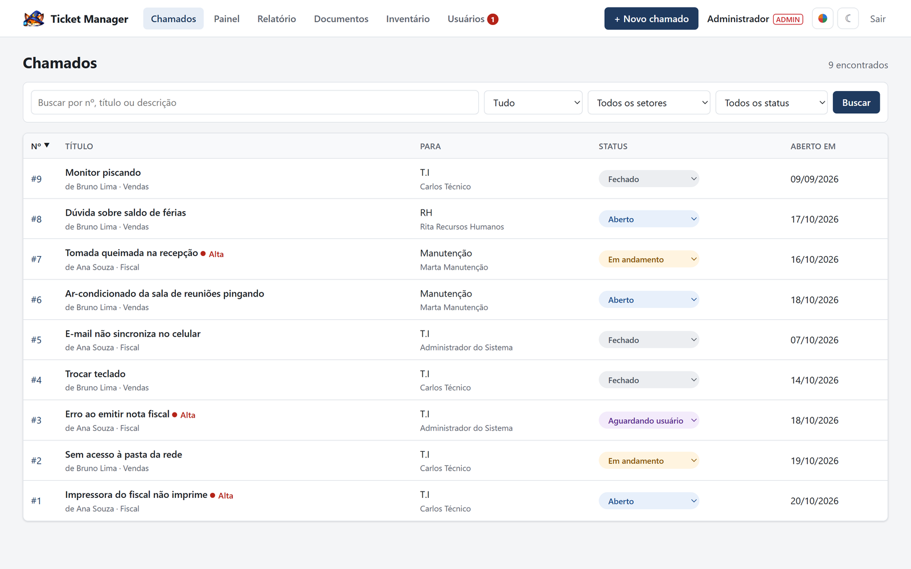

## Antes e agora

| | Versão 1 (desktop) | Versão 2 (web) |
|---|---|---|
| Acesso | Programa instalado em cada computador | Navegador; nada para instalar |
| Atualização | Máquina por máquina | Uma vez no servidor; todos recebem na hora |
| Linguagem | Lazarus / Pascal | Python (Flask), HTML, CSS e JavaScript |
| Banco de dados | Oracle | PostgreSQL, com migrações versionadas |
| Quem recebe chamados | A T.I | Qualquer setor, direto para um funcionário |
| Avisos | Só na abertura do chamado | Chamado novo, resposta, mudança de status, encaminhamento e encerramento |
| Além dos chamados | — | Painel, relatórios Excel/PDF, inventário de TI e documentos internos |

## Funcionalidades

### Chamados para qualquer setor

Quem abre escolhe o **setor de destino** e o **funcionário** que vai atender, define a prioridade
e pode anexar prints, PDFs e planilhas. A lista tem busca, filtros e ordenação, e quem pediu
avalia o atendimento quando o chamado é encerrado.

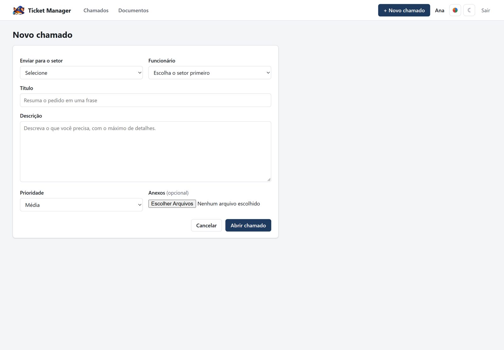

### Atendimento com histórico

Cada chamado tem conversa, anexos e o histórico de tudo o que aconteceu. Quem atende muda o
status (Aberto, Em andamento, Aguardando usuário, Fechado) e pode encaminhar para outra pessoa
ou outro setor; o status também muda direto na lista, sem abrir o chamado. Todos que atendem um
setor veem os chamados dele.

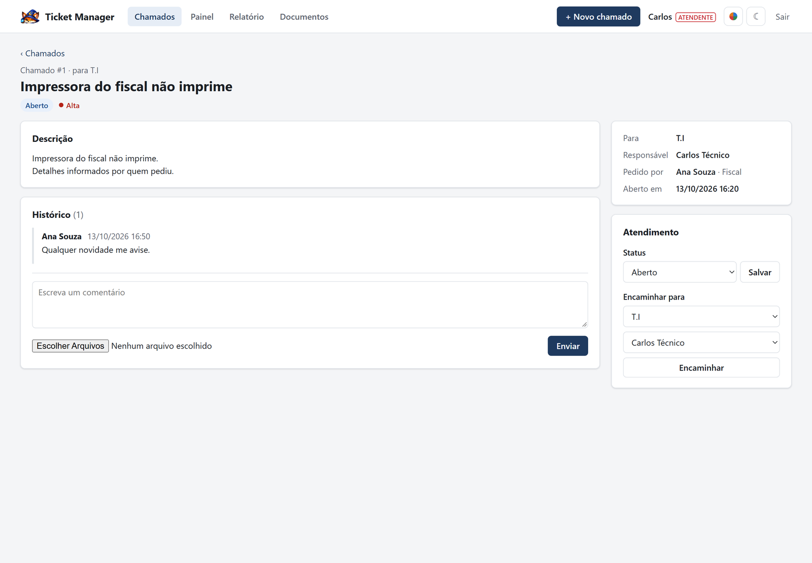

### Avisos por e-mail

O servidor de e-mail da empresa avisa automaticamente: o funcionário quando recebe um chamado,
quem pediu quando há resposta ou mudança de status, e o novo responsável quando o chamado é
encaminhado. O CPD é avisado quando alguém cria uma conta ou pede nova senha. Ninguém recebe aviso
da própria ação.

### Painel e relatórios

Chamados em aberto, sem responsável, abertos e encerrados no período e tempo médio até encerrar,
com gráficos por setor, status, responsável, prioridade, avaliação e mês. O tempo médio conta só
o **horário de expediente** (segunda a sexta, das 7h às 18h): um chamado aberto na sexta às 17h e
fechado na segunda às 8h levou 2 horas. O relatório do período sai em **Excel** ou **PDF**
(supervisores e administradores).

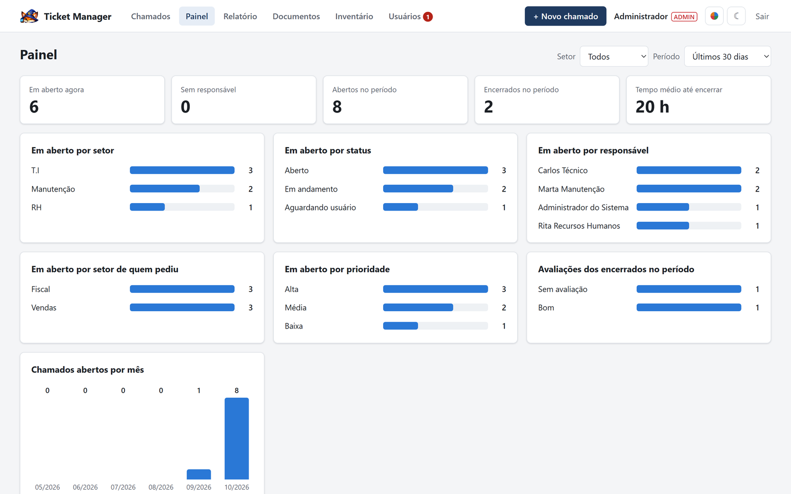

### Inventário de TI

Equipamentos cadastrados com o **número de patrimônio** que já está na etiqueta, com configuração
do computador (inclusive a licença do Windows) e dados de rede (hostname, IP, MAC). Cada um fica com um usuário, um setor ou em
estoque, e toda troca vai para o histórico, com data e quem fez. Para vários equipamentos do
mesmo lote, **Clonar** copia tipo, modelo e configuração. A lista exporta para Excel.

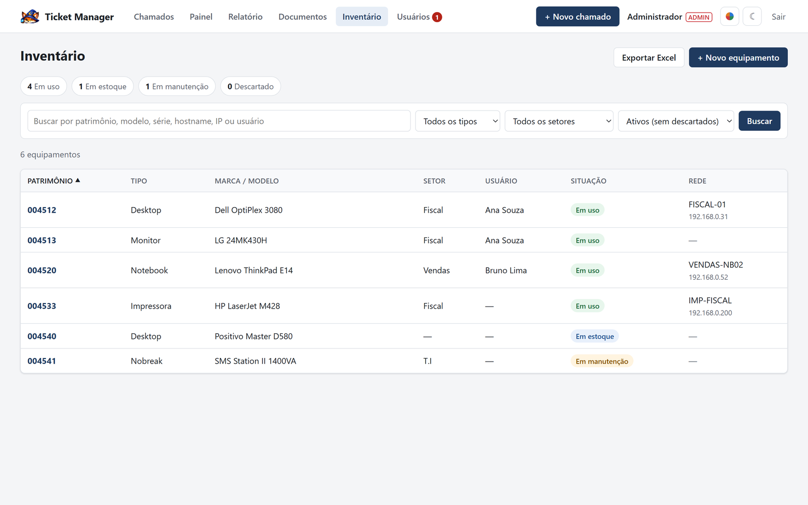

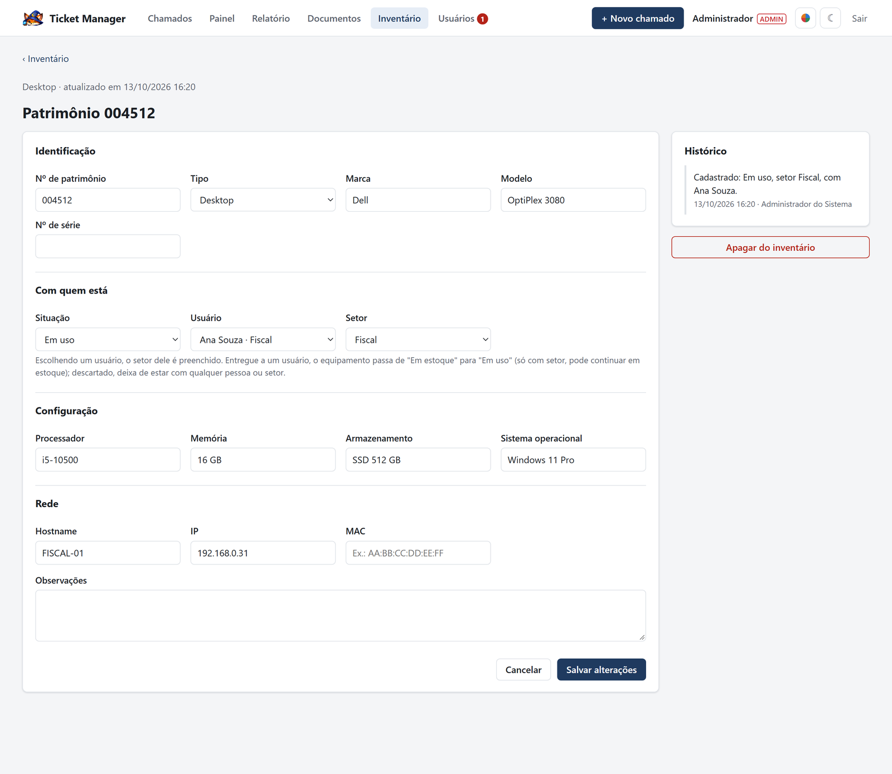

### Documentos internos

Termos, regras, procedimentos e formulários da empresa num lugar só. Supervisores e
administradores consultam e baixam; o administrador publica e troca as versões.

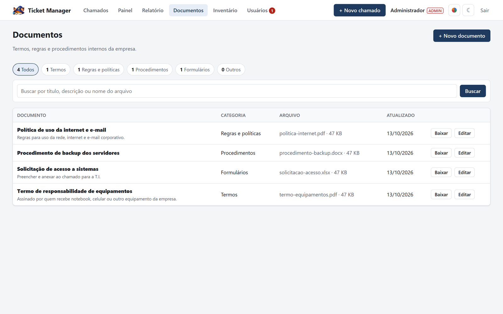

### Contas e acesso

O administrador cadastra e edita as contas numa tela só: nome, usuário, e-mail, setor, nível de
acesso (Usuário, Supervisor ou Administrador) e quem atende chamados, além de liberar nova
senha, desativar e apagar contas criadas por engano. Na conta cadastrada pelo administrador, a
pessoa cria a própria senha no primeiro acesso. Quem esquece a senha clica em **Solicitar nova senha** no login, o CPD recebe
um e-mail e libera uma nova.

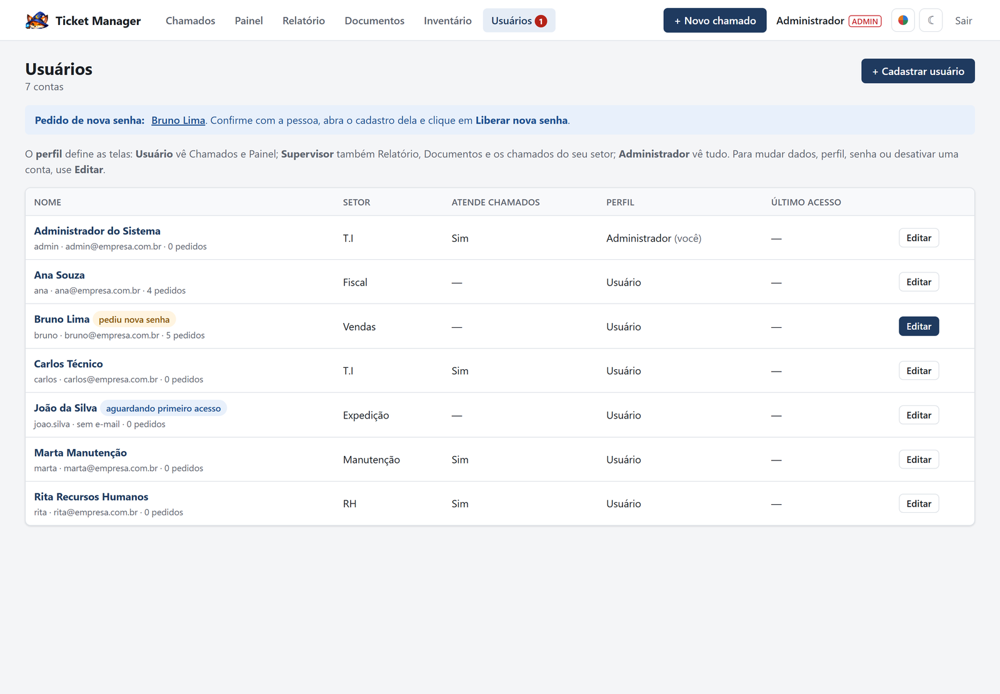

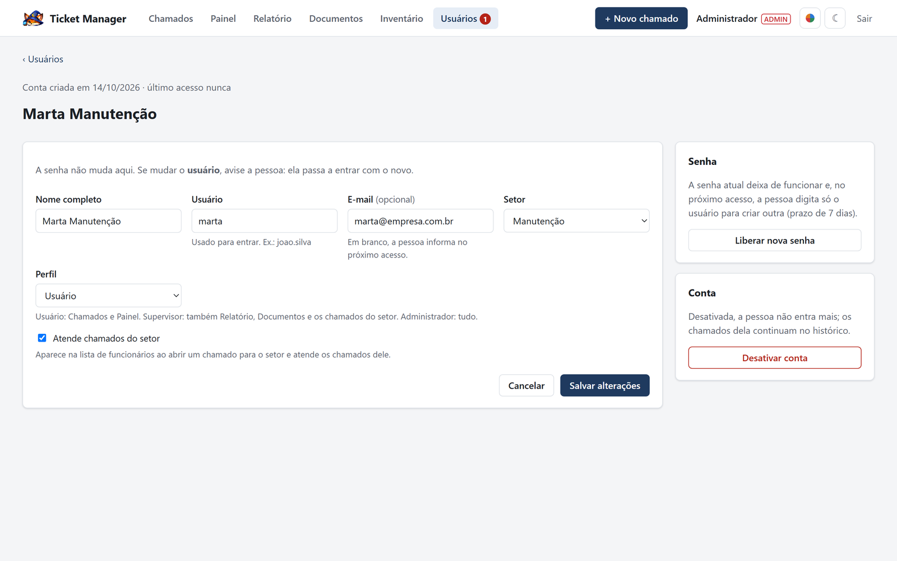

### Modo escuro e temas de cor

Cada pessoa escolhe claro ou escuro e uma de 8 cores, com 5 níveis de intensidade. São 80
combinações, e um teste automático confere o contraste de todas pelo padrão de acessibilidade
WCAG. As cores de status e de alerta não mudam.

| Modo escuro | Tema verde | Laranja no escuro |
|---|---|---|
| 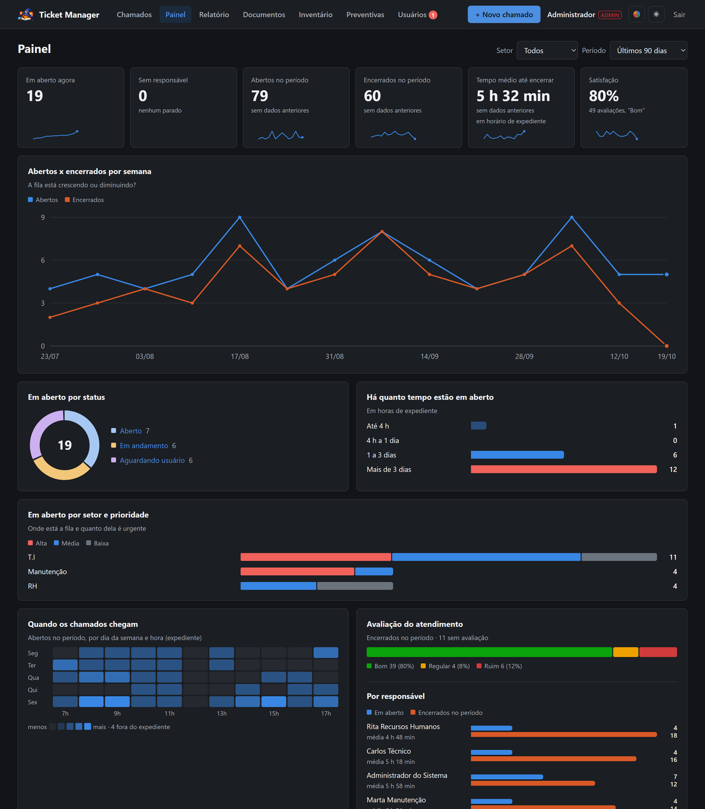 | 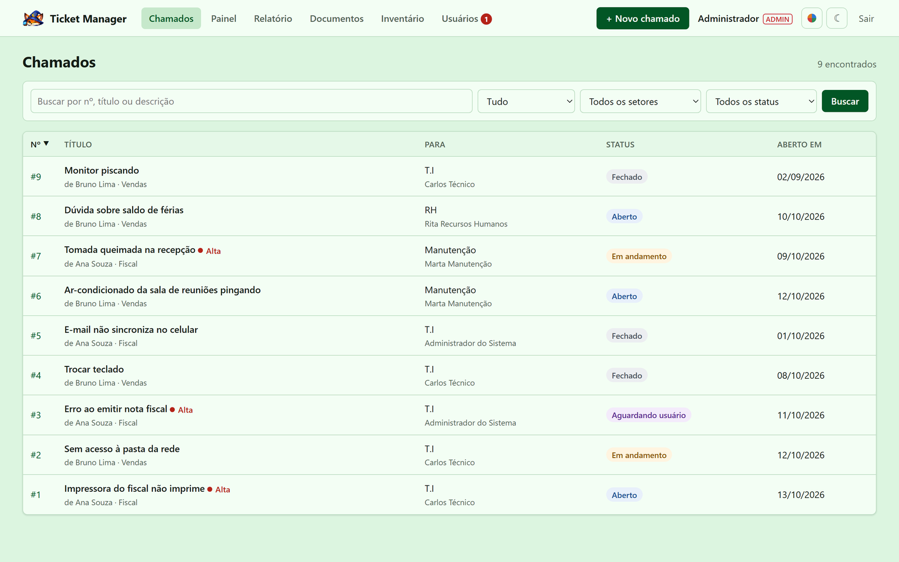 | 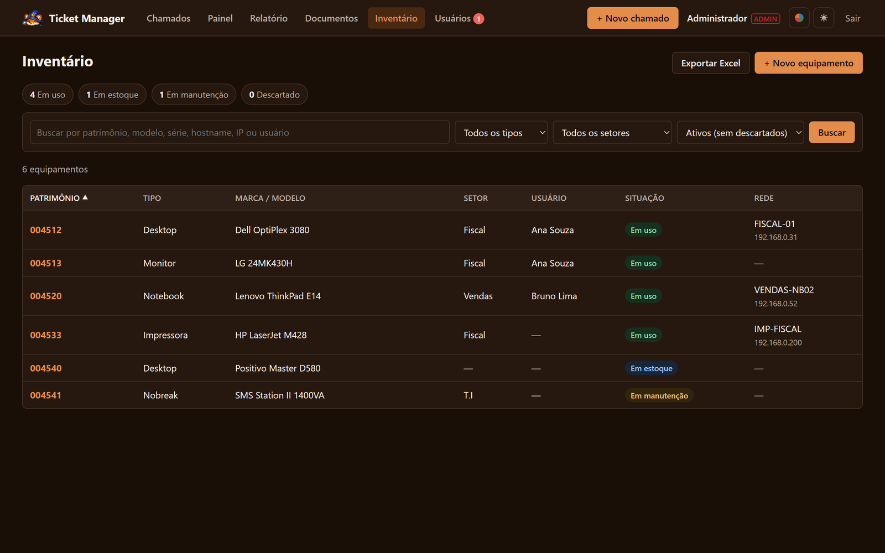 |

## Quem vê o quê

| | Chamados | Painel | Relatório | Documentos | Inventário e Usuários |
|---|---|---|---|---|---|
| **Usuário** | os que abriu (+ os do setor, se atende) | sim | — | — | — |
| **Supervisor** | os do seu setor + os que abriu | sim | do seu setor | consulta | — |
| **Administrador** | todos | todos os setores | todos os setores | consulta e publica | sim |

As telas dependem só do nível de acesso; marcar **Atende chamados** define quem recebe e atende
os chamados do setor.

## Tecnologia

```
Navegador  →  Nginx  →  Gunicorn + Flask (Python)  →  PostgreSQL
                                   └→  SMTP interno (avisos por e-mail)
```

- **Python 3** com Flask, SQLAlchemy 2 e Alembic (migrações do banco)
- **PostgreSQL** em **Ubuntu Server**, com Gunicorn sob systemd e Nginx na frente
- HTML, CSS e JavaScript próprios, sem framework de interface e sem nada carregado de fora
- Relatórios com openpyxl (Excel) e ReportLab (PDF)

### Segurança e operação

- Senhas guardadas com hash e bloqueio após tentativas erradas seguidas
- Proteção CSRF em todos os formulários e política de conteúdo restritiva (CSP)
- Backup diário do banco e dos anexos, guardado por 14 dias
- 85 testes automáticos cobrindo regras, permissões e telas

Instalação e operação: [deploy/INSTALACAO-UBUNTU.md](../deploy/INSTALACAO-UBUNTU.md) e
[deploy/OPERACAO.md](../deploy/OPERACAO.md).
